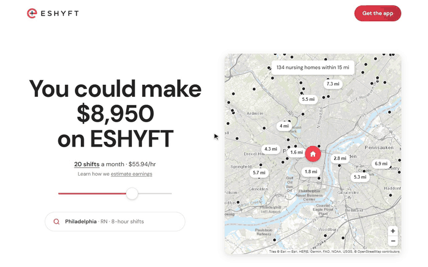
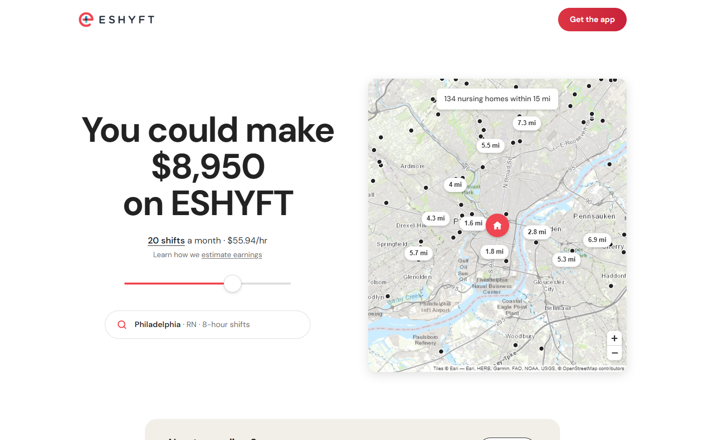

# ESHYFT for Nurses, rebuilt around one number

A concept redesign of **[eshyft.com/nurses](https://eshyft.com/nurses/)** that leads with a personalized earnings estimate ("You could make $X on ESHYFT"), built on public BLS wage data and a map of real nursing homes nearby. It follows the playbook of **[Airbnb's host landing page](https://www.airbnb.com/host/homes)**.

**Live demo:** https://josephfanpm.github.io/eshyft-landing-redesign/ · **Full case study:** [docs/CASE_STUDY.md](docs/CASE_STUDY.md) · **Requirements:** [docs/PRD.md](docs/PRD.md)

[](docs/demo/demo.mp4)

*46-second walkthrough. Click for the full-quality MP4.*

| | |
|---|---|
| **Goal** | Get CNAs, LPNs and RNs to install the nurse app |
| **Bet** | A personal, sourced earnings number persuades better than a generic slogan |
| **Scope** | One page, one conversion, 56 metros across all 30 states ESHYFT serves |
| **Measured** | Lighthouse mobile performance 39 → 97, LCP 24.8 s → 2.3 s (lab, directional) |
| **Status** | Independent concept, deployed to GitHub Pages. Not an official ESHYFT page |

---

## Problem

ESHYFT is a two-sided per diem staffing marketplace, and nurses are the hard side to acquire. The current nurse page describes the product ("Work when you want. Get paid when you're done.") but doesn't answer the two questions a nurse arrives with: **what would I make, and is there work near me?**

The audit of the live page found ([case study §3](docs/CASE_STUDY.md#3-what-the-current-page-gets-wrong)):

- **Generic value prop.** Any gig app could make the same promise.
- **The only pay figure is baked into an image.** Screen readers and search engines can't read it, and it can't be personalized.
- **No answer to "where?"** 30 unsorted state names all link to the same help article.
- **Five competing header actions,** including a facility sales CTA on a nurse page.
- **Missing proof.** The app's verified 4.7★ from 3,991 App Store ratings never appears.
- **Slow.** Lighthouse mobile performance 39, LCP 24.8 s, 4.4 MB.
- **Contrast failures** on brand blue and coral (WCAG AA).

Why the earnings number: Lenny Rachitsky, who led supply growth at Airbnb, wrote that **"At Airbnb, the earnings estimate was an order of magnitude more effective than any other value prop. Any time we hid or obscured it, growth dipped."** ([2019](https://andrewchen.com/grow-marketplace-supply/)). ESHYFT's own hero already hints at it, in a caption inside an image.

<!-- TODO(Joseph): add any nurse research, support-ticket themes or funnel data (e.g. current page → install rate) that confirms pay and location are the deciding questions. The repo has none, so the claim rests on the Airbnb analogy and the page audit. -->

## Target user

CNAs, LPNs and RNs considering per diem work. Mostly on phones, often arriving from ads or search ([§1](docs/CASE_STUDY.md#1-the-brief)). Facility buyers are out of scope for this page; facility links stay in the footer.

## Solution



1. **A personal estimate.** A shifts-per-month slider plus a city / license / shift-length picker drive the headline number.
2. **The method, next to the claim.** "How we estimate earnings" shows the maths with the visitor's own numbers and its BLS source.
3. **A map of real nursing homes** within 15 miles. Tap one for bed count, CMS star rating and one shift's estimated pay.
4. **Proof and reassurance.** Real nurse quotes, the verified App Store rating, Instant Pay, 24/7 support.
5. **One action everywhere: "Get the app."** Phones go straight to ESHYFT's app link; desktop gets a QR code.
6. **Shareable estimates.** State lives in the URL, so recruiters and ads can link to a local number: `?city=pittsburgh-pa&role=RN&shifts=12&hours=12`.

Section-by-section mapping to Airbnb's page: [§5](docs/CASE_STUDY.md#5-section-by-section-what-and-why). More screenshots: [end of the case study](docs/CASE_STUDY.md#more-screenshots).

## My role

Solo project. I framed the problem, audited the live page, chose the model, defined the estimate and its assumptions, built the dataset pipeline, designed and built the page, measured performance and wrote the case study. Implementation was AI-assisted (Claude Code; see the co-author lines in the commit history).

## Key decisions and trade-offs

| Decision | Options considered | Chose | Gave up | Why |
|---|---|---|---|---|
| **Scope** | v1: one page for both sides, with a nurse/facility toggle, agency-cost calculator, consult booking and heavy motion ([`b1988a0`](https://github.com/josephfanpm/eshyft-landing-redesign/commit/b1988a0)) · v2: nurse page only | Rebuilt from scratch as a nurse-only page with one conversion ([`906bf65`](https://github.com/josephfanpm/eshyft-landing-redesign/commit/906bf65)) | The facility funnel and calculator; the animated design | Nurses are the hard side of the marketplace. One audience allows one number and one action ([§2](docs/CASE_STUDY.md#2-why-airbnbs-host-page), [§4](docs/CASE_STUDY.md#4-design-principles)) |
| **Estimate basis** | Raw BLS median · BLS median × uplift · ESHYFT's own posted rates | BLS metro median × 1.15 per diem uplift (`PER_DIEM_UPLIFT`) | Precision. The 15% is a labelled assumption, not a statistic | Public and defensible. Raw staff medians would understate per diem pay. ESHYFT's rates are proprietary, so they stay out of a public repo ([§6](docs/CASE_STUDY.md#6-the-earnings-estimate)) |
| **What the map shows** | "Available shifts" · partner facilities · all certified nursing homes | All CMS-certified nursing homes, names dropped, distance on pins | The stronger "shifts near you" claim | No implied partnerships or invented shifts. Price pins would repeat one number; distance varies ([§7](docs/CASE_STUDY.md#7-the-map)) |
| **Map engine** | MapLibre GL (WebGL vectors) · Leaflet + raster tiles | Leaflet | Vector styling | MapLibre caused a 556 ms long task on a throttled phone. Map JS 287 KB → 45 KB, mobile performance 73 → 97 ([§7](docs/CASE_STUDY.md#7-the-map)) |
| **Defaults** | Lower shift counts that feel attainable · a full month · IP-based city | RN, 20 shifts, Philadelphia ([`6e5d053`](https://github.com/josephfanpm/eshyft-landing-redesign/commit/6e5d053)) | Attainability; a local default | 20 eight-hour shifts is roughly a full-time month. The default is an anchor, so it's a planned experiment ([§6](docs/CASE_STUDY.md#6-the-earnings-estimate), [§11](docs/CASE_STUDY.md#11-how-id-measure-it)) |
| **Production maps cost** | Google Dynamic Maps · Map Tiles in Leaflet · static image first, interactive on tap | Recommend static first, Dynamic Maps on tap | A live map on first paint | Per-load billing is 2–3× cheaper than per-tile. Static-first cuts the assumed planning case from ~$280 to ~$100 a month ([§13](docs/CASE_STUDY.md#13-what-it-would-cost-on-google-maps-platform)) |

<!-- TODO(Joseph): confirm the reason for dropping the two-sided v1. The commits record what changed ("Start over from scratch", "Replace the previous dark, animation-heavy design") but not why. -->

## Success metrics

**Measured.** Lighthouse 12, 2026-10-16. The redesign was served locally and the live page from production, so treat this as directional.

| | Live eshyft.com/nurses | Redesign (mobile) | Redesign (desktop) |
|---|---|---|---|
| Performance | 39 | **97** | **99** |
| Accessibility | 91 | **100** | **100** |
| Best practices | 75 | **100** | **100** |
| SEO | 92 | **100** | **100** |
| Largest Contentful Paint | 24.8 s | **2.3 s** | **1.0 s** |
| Total Blocking Time | 660 ms | **40 ms** | **0 ms** |
| Page weight | 4,378 KiB | 458 KiB | 319 KiB |

No user-facing results exist yet. The page hasn't run with real traffic.

<!-- TODO(Joseph): if this concept was shown to the ESHYFT team or any part shipped, add what happened (feedback, adoption, test results). -->

**KPIs I would track.** Events are already instrumented in [`src/lib/analytics.ts`](src/lib/analytics.ts).

| Metric | Type | Source |
|---|---|---|
| App-store click-through per visitor | Primary (proxy) | `get_app_clicked`, `store_clicked` |
| Installs attributed through the Branch link | Primary (outcome) | Branch |
| Estimate engagement rate | Leading | `estimate_changed`, `location_changed` |
| Method opened rate | Trust signal | `estimate_method_opened` |
| Map engagement | Leading | `map_home_opened` |
| Retention of nurses acquired via the estimate | Guardrail: do expectations match reality? | App data |

<!-- TODO(Joseph): add the current page's baseline install rate and a target lift, if you can share them. -->

## Prioritization and roadmap

Sourced from the case study's experiments ([§11](docs/CASE_STUDY.md#11-how-id-measure-it)) and next steps ([§12](docs/CASE_STUDY.md#12-limitations-and-next-steps)).

| | Item | Why this slot |
|---|---|---|
| **Now** (done) | Estimate hero, method dialog, map, one CTA, dataset pipeline, funnel events | The minimum needed to test the core bet |
| **Next** | A/B: estimate vs current hero | Validates the core bet before anything else |
| | A/B: default shifts (4 vs 8 vs 12) | The default anchors expectations |
| | Geolocation default instead of Philadelphia | Makes the first number local without a tap |
| | ESHYFT's median posted rate replaces BLS × 1.15 | Removes the biggest assumption; needs internal data |
| **Later** | Real open shifts and rates as map pins | Biggest upgrade, but needs live marketplace data |
| | Spanish version | Reaches bilingual CNAs |
| | Licensed map tiles (Google, static first) | Required for production, not for a demo |
| | Prerendered HTML | First paint without JavaScript; performance is already strong |

## Technical overview

**Stack:** Vite 8 · React 19 · TypeScript · Tailwind CSS v4 · Leaflet · DM Sans. Motion is CSS transitions plus Leaflet's `flyTo`; there's no animation library.

- **Reproducible dataset.** [`scripts/build-dataset.mjs`](scripts/build-dataset.mjs) (`npm run data`) rebuilds everything from two public sources with no API keys:

  | Source | Provides |
  |---|---|
  | BLS OEWS, May 2025 | Median hourly wage for CNAs (31-1131), LPNs (29-2061) and RNs (29-1141) per metro |
  | CMS Nursing Home Provider Information, processed 2026-09-01 | All 14,690 certified nursing homes, with coordinates, beds and star rating |

  Output: 56 metros and 2,763 nursing homes within 15 miles of a metro center. Philadelphia BLS medians: CNA $22.22 · LPN $34.00 · RN $48.64 per hour, before the uplift. Facility names are dropped, so the page never implies a specific home is an ESHYFT partner. Details: [§8](docs/CASE_STUDY.md#8-the-dataset).
- **One explainable formula** in [`src/lib/estimate.ts`](src/lib/estimate.ts): shifts × hours × (BLS median × `PER_DIEM_UPLIFT`). One constant to tune or A/B test.
- **URL as state.** [`src/lib/useEstimatorState.ts`](src/lib/useEstimatorState.ts) syncs the estimate to the query string and validates every parameter.
- **Fast by default.** The number renders from the main bundle with no network call. The map and per-city data (~4 KB each) load lazily ([`NursingHomeMap.tsx`](src/components/NursingHomeMap.tsx), [§10](docs/CASE_STUDY.md#10-performance)).
- **Accessible.** Native `<input type="range">`, `<dialog>` and `<details>`, keyboard-focusable pins, `prefers-reduced-motion` respected ([§9](docs/CASE_STUDY.md#9-accessibility)).
- **CI/CD.** [`.github/workflows/deploy.yml`](.github/workflows/deploy.yml) lints (oxlint), type-checks, builds and deploys to GitHub Pages on every push to `main`. There are no automated tests.

```
scripts/build-dataset.mjs         BLS + CMS → src/data/cities.json, public/data/nursing-homes/*.json
src/lib/estimate.ts               the estimate formula, city data, formatting
src/lib/useEstimatorState.ts      estimator state ↔ URL query string
src/lib/analytics.ts              funnel events (GTM-compatible dataLayer)
src/components/EarningsHero.tsx   headline, slider, location pill, lazy map
src/components/NursingHomeMap.tsx Leaflet map, pins, per-shift cards
src/sections/                     the rest of the page, one file per section
docs/CASE_STUDY.md                research, reasoning, trade-offs
docs/PRD.md                       requirements and acceptance criteria
```

## Run it

```bash
npm install
npm run dev       # http://localhost:5173
npm run build     # type-check + production build
npm run lint
npm run data      # rebuild the dataset from BLS + CMS
```

You can link straight to any estimate: `?city=pittsburgh-pa&role=RN&shifts=12&hours=12`

## Credits and license

Code under the [MIT License](LICENSE). Sources for every number on the page and every quotation in the case study are in [§14](docs/CASE_STUDY.md#14-where-every-number-comes-from).

*Independent concept for portfolio purposes; not an official ESHYFT page. The ESHYFT name and mark belong to ESHYFT. Testimonials are quoted from eshyft.com/nurses. Map tiles © Esri; map data © OpenStreetMap contributors.*
