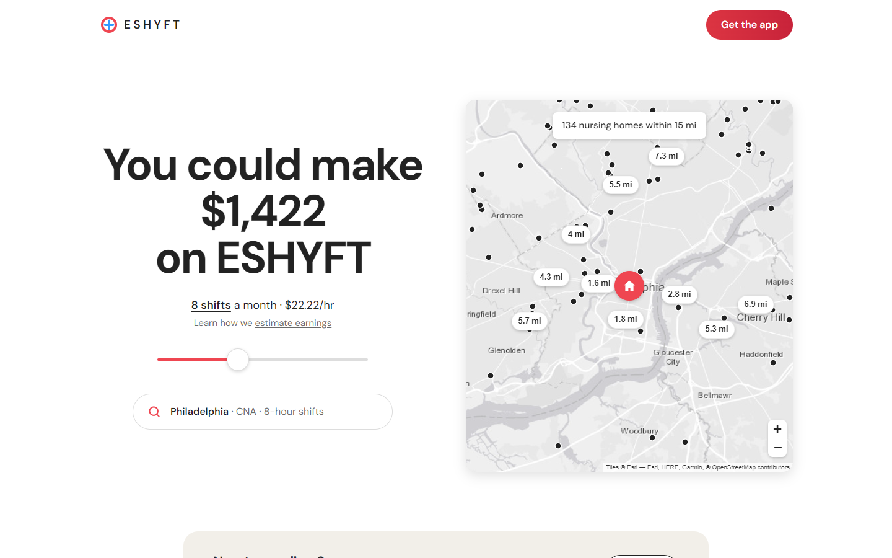

# ESHYFT for Nurses, rebuilt as Airbnb's host page

A concept redesign of **[eshyft.com/nurses](https://eshyft.com/nurses/)**, the page that recruits CNAs, LPNs and RNs to ESHYFT's per diem staffing marketplace. It follows the playbook of **[Airbnb's host landing page](https://www.airbnb.com/host/homes)**. The page leads with a personalized, interactive earnings estimate ("You could make $X on ESHYFT") on top of a live map of nursing homes near you. The estimate is built on a real dataset of public wage and facility data. Philadelphia is the default city.

**Live demo:** https://josephfanpm.github.io/eshyft-landing-redesign/
**Full write-up:** [docs/CASE_STUDY.md](docs/CASE_STUDY.md) explains why every part of the design was chosen.



---

## Why Airbnb's host page?

Airbnb's host page solves ESHYFT's problem. It persuades someone to supply their time or asset to a two-sided marketplace, and its answer is one personalized number. Lenny Rachitsky ran supply growth at Airbnb. He has written that earnings estimates were **"an order of magnitude more effective than any other value prop"** for recruiting hosts, and that growth dipped whenever they were hidden. The current ESHYFT nurses page already hints at this idea in a caption inside an image ("Earn an estimated $2,000 for working 10 invited shifts"). This redesign makes it the page.

| Airbnb host page | This redesign |
|---|---|
| "Your home could make **$2,087** on Airbnb" | "You could make **$1,422** on ESHYFT" |
| Slider: nights per month | Slider: shifts per month (1–20) |
| Search pill: *Toronto · Entire place · 2 bedrooms* | Search pill: *Philadelphia · CNA · 8-hour shifts* |
| Map of nearby listings with price pins | Map of nearby nursing homes with distance pins; tap one for a per-shift estimate |
| "Learn how we estimate earnings" | The same link, opening the maths with your own numbers and its BLS source |
| "Join millions of hosts": 3 icon columns | "Work per diem on your terms": flexible / pays fast / supported |
| Co-host cards | Nurse testimonial cards (real quotes) + verified 4.7★ App Store rating |
| AirCover checklist | "Every shift is backed by ESHYFT": Instant Pay, 24/7 support, Joint Commission |
| Phones on gray cards | "Everything happens in the app": shifts + Instant Pay screens |
| "Your questions, answered" | Grouped FAQ + "Contact support" |

## The dataset

`npm run data` runs [scripts/build-dataset.mjs](scripts/build-dataset.mjs), which rebuilds everything from two public sources with no API keys:

| Source | What it provides |
|---|---|
| **U.S. Bureau of Labor Statistics, OEWS (May 2025)** | Median hourly wage for CNAs (31-1131), LPNs (29-2061) and RNs (29-1141) in each metro area |
| **CMS Nursing Home Provider Information (processed 2026-09-01)** | All 14,690 Medicare/Medicaid-certified nursing homes, with coordinates, bed count and CMS star rating |

- **Output:** 56 metros covering all 30 states ESHYFT serves, and 2,763 nursing homes within 15 miles of a metro center.
- **Philadelphia (the default):** CNA $22.22/hr · LPN $34.00/hr · RN $48.64/hr, with 134 nursing homes within 15 miles.
- **Privacy:** facility names are dropped, so the page never implies a specific nursing home is an ESHYFT partner.

## Results

Lighthouse 12 (simulated throttling), same day, compared with the live page:

| | Live eshyft.com/nurses | Redesign (mobile) | Redesign (desktop) |
|---|---|---|---|
| Performance | 39 | **97** | **99** |
| Accessibility | 91 | **100** | **100** |
| Best practices | 75 | **100** | **100** |
| SEO | 92 | **100** | **100** |
| Largest Contentful Paint | 24.8 s | **2.3 s** | **1.0 s** |
| Total Blocking Time | 660 ms | **40 ms** | **0 ms** |
| Page weight | 4,378 KiB | 458 KiB | 319 KiB |

The redesign was served locally and the live page from production, so these numbers are directional. The case study explains how the map went from 287 KB to 45 KB of JavaScript.

## Stack

**Vite 8 · React 19 · TypeScript · Tailwind CSS v4 · Leaflet · DM Sans.** Motion is CSS transitions plus Leaflet's `flyTo`. There's no animation library.

## Run it

```bash
npm install
npm run dev       # http://localhost:5173
npm run build     # type-check + production build
npm run lint
npm run data      # rebuild the dataset from BLS + CMS
```

You can link straight to any estimate: `?city=pittsburgh-pa&role=RN&shifts=12&hours=12`

## Structure

```
scripts/build-dataset.mjs        BLS + CMS → src/data/cities.json, public/data/nursing-homes/*.json
src/lib/estimate.ts              the estimate formula, city data, formatting
src/lib/useEstimatorState.ts     estimator state ↔ URL query string
src/components/EarningsHero.tsx  headline, slider, location pill, lazy map
src/components/NursingHomeMap.tsx Leaflet map, pins, per-shift cards
src/sections/                    the rest of the page, one file per section
docs/CASE_STUDY.md               research, reasoning, trade-offs
```

---

*Independent concept for portfolio purposes; not an official ESHYFT page. The ESHYFT name and mark belong to ESHYFT. Testimonials are quoted from eshyft.com/nurses. Map tiles © Esri; map data © OpenStreetMap contributors.*
