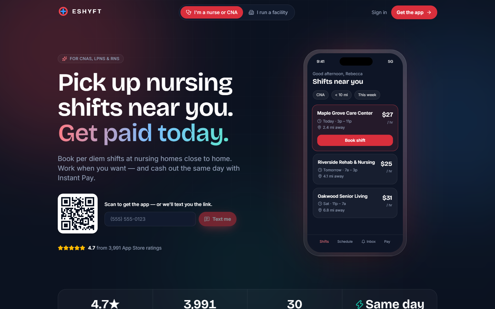
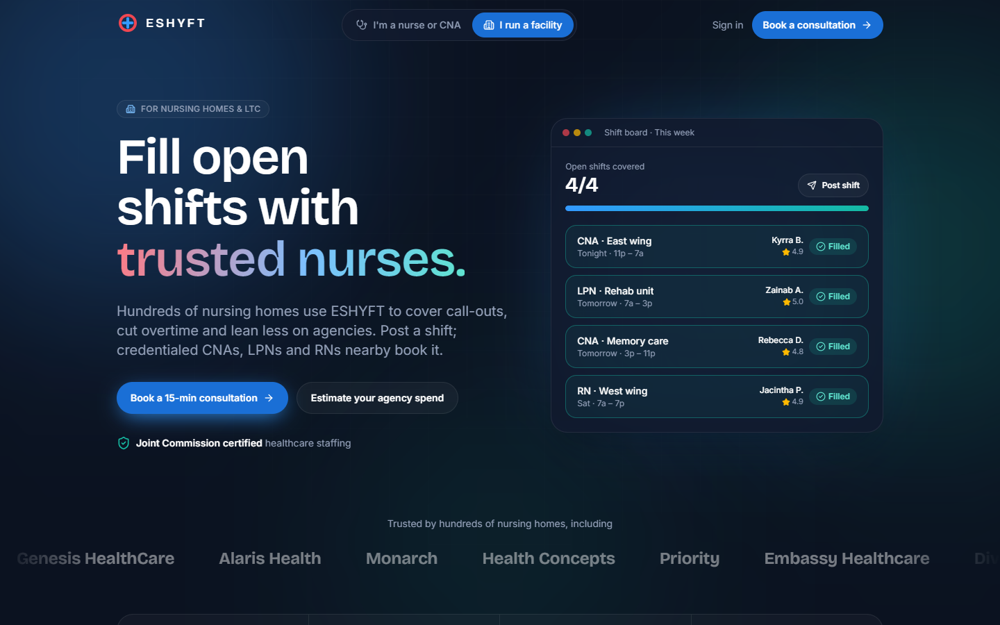

# ESHYFT Landing Page — a product-led redesign

> A concept redesign of [eshyft.com](https://eshyft.com), a two-sided marketplace that connects per diem CNAs, LPNs and RNs with shifts at nursing homes. I research what's holding the current page back, apply what Y Combinator, Nielsen Norman Group and the best marketplaces (Airbnb, Uber, Lyft, DoorDash, Clipboard, Nursa) do, and ship it as a fast, accessible, animated React site.

**Two jobs, one page:** get **nurses to download the app** and get **facilities to book a sales consultation**.

📖 **Read the full case study → [docs/CASE_STUDY.md](docs/CASE_STUDY.md)**

<p align="center">
  
  
</p>

---

## Results at a glance

Lighthouse (v12, simulated mobile throttling) on the production build, compared with the live site on the same day:

| | Live eshyft.com | This redesign (nurse / facility) |
|---|---|---|
| Performance | 39 | **95 / 93** |
| Accessibility | 91 | **100 / 100** |
| Best practices | 75 | **100 / 100** |
| SEO | 92 | **100 / 100** |
| Largest Contentful Paint | 27.1 s | **2.4 s / 2.9 s** |
| Total Blocking Time | 690 ms | **30 ms / 10 ms** |
| Total transfer size | 5,042 KiB | **247 / 254 KiB** |
| Network requests | 172 | **7 / 8** |

> These are lab numbers measured on 2026-10-16. The redesign was served locally while the live site was served from production, and the live page carries real-world weight (analytics, chat, forms, CMS) that a concept doesn't. Treat this as directional, not a like-for-like benchmark. The case study covers [the caveats](docs/CASE_STUDY.md#7-performance--accessibility).

## What changed and why (summary)

| # | Change | Why |
|---|---|---|
| 1 | **Split the page by audience** with a toggle and deep-linkable `#nurses` / `#facilities` views | Two audiences with opposite needs; every leading marketplace gives each side its own page |
| 2 | **One contextual CTA** instead of 5 competing header buttons | Clarity: the CTA becomes "Get the app" or "Book a consultation" depending on who you are |
| 3 | **Plain-language, benefit-first headlines** | Passes Michael Seibel's "explain it back" test; written at a ~6th-grade reading level |
| 4 | **Verified 4.7★ / 3,991-rating proof** replaces the unsupported "top-rated" claim | Third-party proof is trusted more than self-claims (NN/g). No competitor shows ratings, so it's a differentiator |
| 5 | **Nurse earnings estimator** | At Airbnb, earnings estimates were "an order of magnitude more effective" than any other supply value prop |
| 6 | **Desktop QR + "text me the link"; store badges on mobile** | Bridges desktop visitors to a mobile download (Lyft/DoorDash pattern) |
| 7 | **Coded, animated product mockups** | "Show the product" is YC's top website note; code-built UI is sharp and weighs almost nothing |
| 8 | **State checker** replaces a list of 30 links that all point to the same article | Answers the real question: "Can I work in my state?" |
| 9 | **Agency-cost estimator** for facilities, grounded in Health Affairs data | Quantifies the buyer's pain without inventing ESHYFT savings claims |
| 10 | **Inline consult form → instant time-slot booking** | Replaces a hidden modal and "we'll reach out" with booking the meeting in-flow |
| 11 | **Pain → fix narrative, process steps, FAQs** | De-risks the sales call for B2B buyers |
| 12 | **Accessible brand colors** | White on the brand coral/blue fails WCAG AA, so I added `-strong` shades that pass |
| 13 | **Funnel instrumentation** | Every conversion-relevant interaction emits an event, so the redesign can be measured and A/B tested |

## Tech stack

| Layer | Choice | Why |
|---|---|---|
| Build | **Vite 8** + **React 19** + **TypeScript** | Fast dev loop, static `dist/` that deploys anywhere |
| Styling | **Tailwind CSS v4** (CSS-first `@theme` tokens) | Design tokens in CSS, no config file, tiny output |
| Motion | **Motion 14** (`motion/react`) via `LazyMotion` + `m` | Layout animations, presence, scroll-linked effects. The feature bundle loads async |
| Smooth scroll | **Lenis** | Disabled automatically for `prefers-reduced-motion` |
| Icons | **lucide-react** | Tree-shaken SVG icons |
| QR | **qrcode.react** | Desktop-to-mobile bridge |
| Fonts | Self-hosted **Bricolage Grotesque** + **Inter** (variable) | No third-party font requests |

I deliberately skipped GSAP, Three.js, Lottie and Rive. Each adds 60–250 KB+ for effects this page doesn't need. See the [library research](docs/CASE_STUDY.md#6-choosing-the-stack).

## Motion design

- **Audience toggle:** a spring-animated pill (shared `layoutId`), with a blur-crossfade between pages and the ambient background shifting coral → blue
- **Phone mockup:** loops browse → **Booked** → Instant Pay notification
- **Shift board:** open shifts flip to **Filled** with the matched nurse
- **Scroll effects:** a progress bar, a "how it works" line that draws as you scroll, staggered reveals
- **Numbers:** counters that count up into view, and calculator results that spring between values
- **Logo and testimonial marquees:** CSS-only, pause on hover

All of it respects `prefers-reduced-motion`. Animations become instant, the marquees stop, and smooth scroll turns off. The hero `<h1>` is never hidden behind an entrance animation, because it's the LCP element.

## Run it locally

```bash
npm install
npm run dev        # http://localhost:5173
npm run build      # type-check + production build to dist/
npm run preview    # serve the production build
npm run lint
```

Deep links: `/#nurses` (default) and `/#facilities`.

## Deploy

- **GitHub Pages:** `.github/workflows/deploy.yml` builds with `GH_PAGES=1` (sets the `/eshyft-landing-redesign/` base path) and publishes on every push to `main`. Enable it under *Settings → Pages → Source: GitHub Actions*.
- **Vercel / Netlify:** import the repo; it's auto-detected as Vite (output `dist`).

## Project structure

```
src/
  data/content.ts           # all copy + facts (sourced) + illustrative values (labelled)
  lib/                      # analytics, audience routing (URL hash), scroll, formatting
  components/               # toggle, nav, mockups, marquee, counters, FAQ, download panel…
  sections/
    nurse/                  # hero, earnings estimator, how-it-works, Instant Pay, testimonials, state checker
    facility/               # hero, pain→fix, agency-cost estimator, process, consult form
    shared/                 # hero shell, proof bar, cross-sell
docs/
  CASE_STUDY.md             # full research, reasoning and trade-offs
  screenshots/
```

---

**Disclaimer:** This is an independent concept for portfolio purposes and is not the official ESHYFT website. The ESHYFT name, mark and customer names belong to their owners. Testimonials are quoted from eshyft.com, and ratings come from the public App Store API. Pay and savings figures are labelled illustrative estimates. Forms don't send data.
