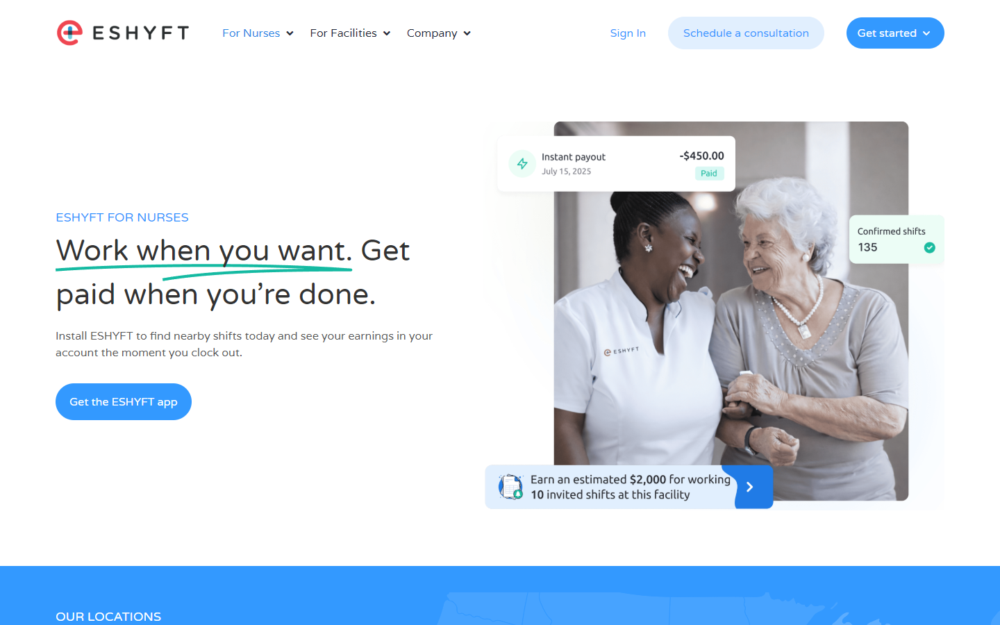
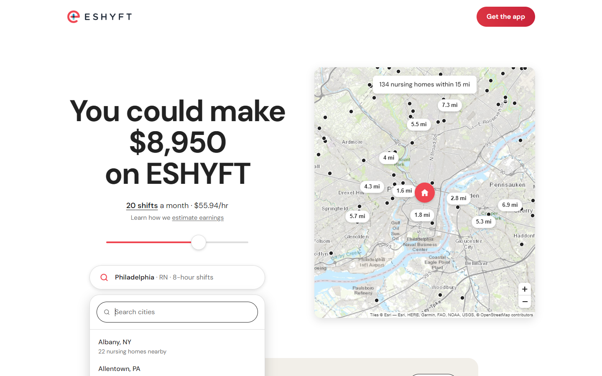
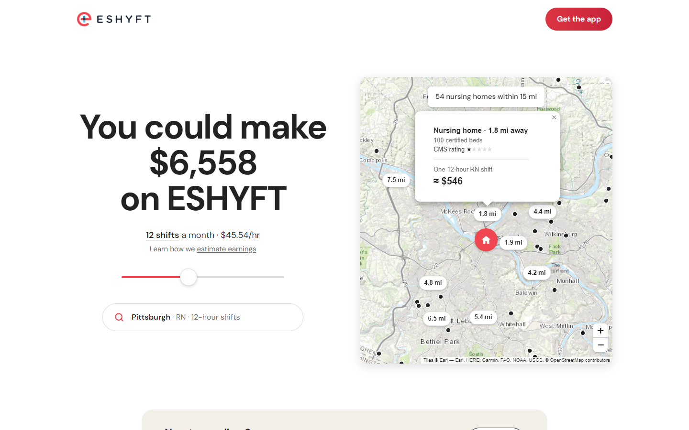
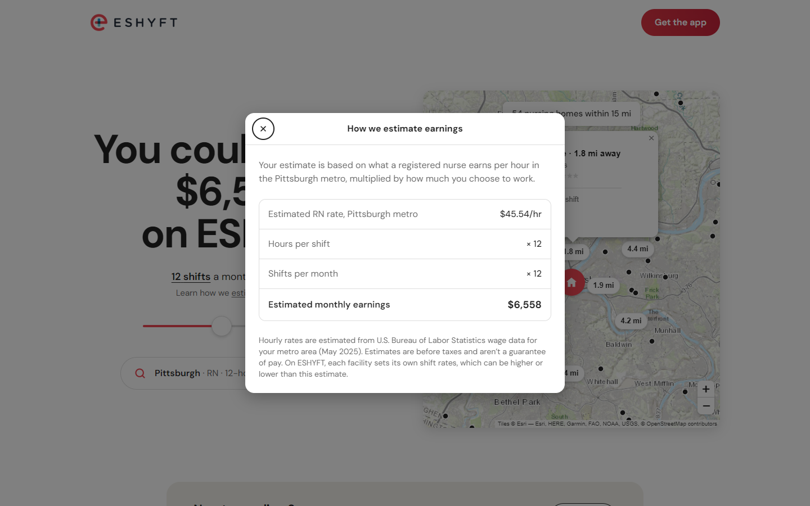
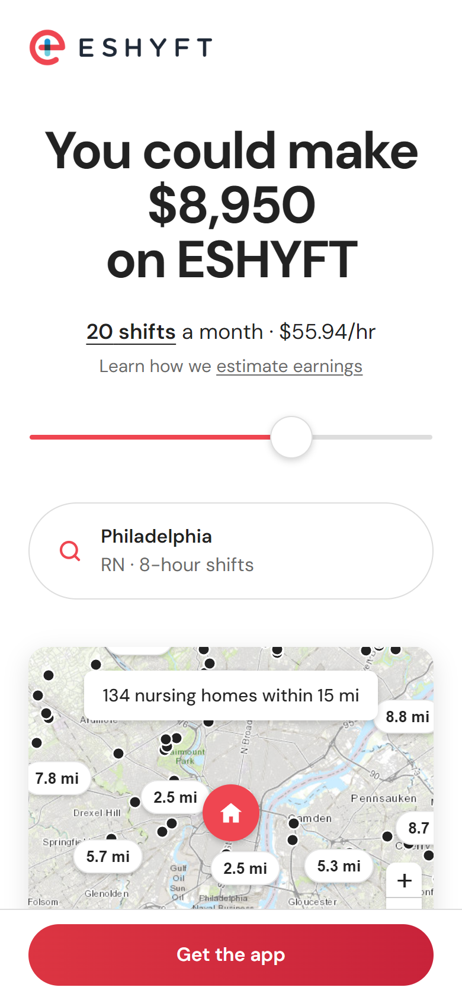
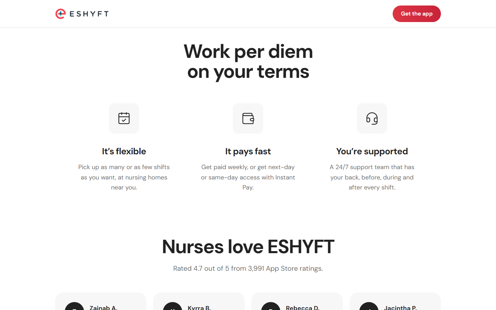
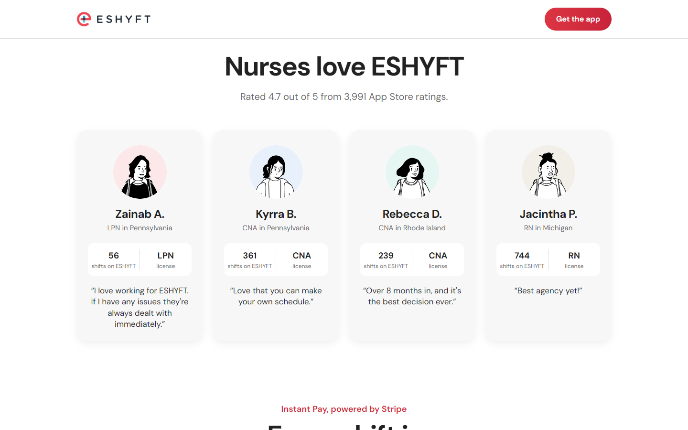
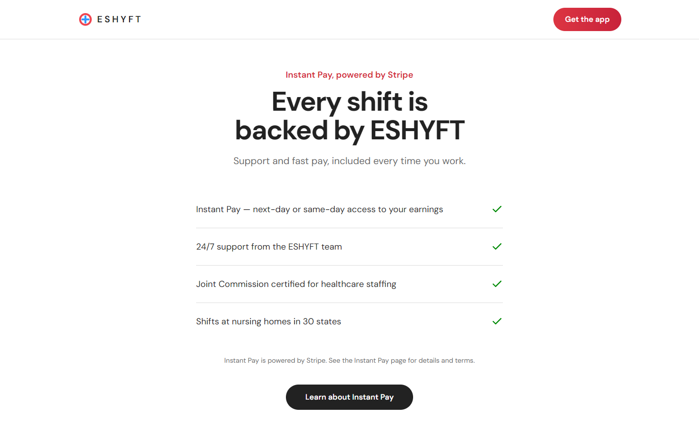
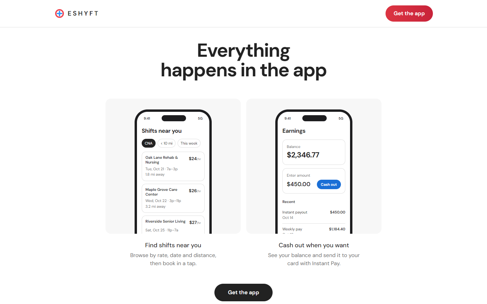

# Case study: redesigning ESHYFT's nurse page around one number

**Author:** Joseph Fan · **October 2026** · Independent concept, not an official ESHYFT page

---

## TL;DR

ESHYFT's nurse page has one job: **get CNAs, LPNs and RNs to download the app.** Today it describes the product ("Work when you want. Get paid when you're done.") without answering the question a nurse actually has: *what would I make, and where?*

I rebuilt the page using the **Airbnb host page** as the model, because that page is the best-tested answer to "convince someone to supply a marketplace." The redesign leads with a personalized number:

> **You could make $8,950 on ESHYFT**
> 20 shifts a month · $55.94/hr · Philadelphia · RN

A slider, a location/license picker and a live map of the **134 nursing homes within 15 miles of Philadelphia** let the visitor make the estimate their own. Every number comes from a reproducible dataset built from **BLS wage data** and **CMS's federal nursing home directory**, covering 56 metros in all 30 states ESHYFT serves.

On mobile, Lighthouse performance went from **39 to 97** and largest contentful paint (LCP, when the main content finishes loading) from **24.8 s to 2.3 s**. Accessibility, best practices and SEO all reach **100**.

---

## Contents

1. [The brief](#1-the-brief)
2. [Why Airbnb's host page](#2-why-airbnbs-host-page)
3. [What the current page gets wrong](#3-what-the-current-page-gets-wrong)
4. [Design principles](#4-design-principles)
5. [Section by section: what and why](#5-section-by-section-what-and-why)
6. [The earnings estimate](#6-the-earnings-estimate)
7. [The map](#7-the-map)
8. [The dataset](#8-the-dataset)
9. [Accessibility](#9-accessibility)
10. [Performance](#10-performance)
11. [How I'd measure it](#11-how-id-measure-it)
12. [Limitations and next steps](#12-limitations-and-next-steps)
13. [What it would cost on Google Maps Platform](#13-what-it-would-cost-on-google-maps-platform)
14. [Where every number comes from](#14-where-every-number-comes-from)

---

## 1. The brief

- **Page:** [eshyft.com/nurses](https://eshyft.com/nurses/)
- **Audience:** CNAs, LPNs and RNs considering per diem work, mostly on phones and often arriving from ads or search.
- **One conversion:** install the nurse app (App Store or Google Play).
- **Constraints:**
  - Don't invent facts.
  - Don't imply partnerships that may not exist.
  - Be fast on a mid-range phone.
  - Meet WCAG AA.

---

## 2. Why Airbnb's host page

Two-sided marketplaces have a "hard side": the supply that's harder to acquire and keep. As Andrew Chen puts it in *The Cold Start Problem* (2021), "For marketplaces, the hard side is usually the 'supply' side of the network." For Airbnb that's hosts; for ESHYFT it's nurses. Airbnb's host page is the most refined page anyone has built for winning that side.

- **The number is the pitch.** Lenny Rachitsky, who led supply growth at Airbnb, writes: **"At Airbnb, the earnings estimate was an order of magnitude more effective than any other value prop. Any time we hid or obscured it, growth dipped."** ([*Twenty Eight Ways to Grow Supply in a Marketplace*](https://andrewchen.com/grow-marketplace-supply/), 2019)
- **It's personal and interactive.** The visitor moves a slider and picks their city, so the number becomes *theirs*. A static "earn up to $X" claim reads as marketing.
- **It's honest by design.** "Learn how we estimate earnings" sits right under the number, showing the method upfront rather than in fine print. That builds trust (NN/g's "upfront disclosure"), and the method stays visible right where the claim is made.
- **It's calm.** One accent color, big type, lots of white space, and no motion for motion's sake. Every section is one idea.

ESHYFT already gestures at this idea. The current hero image contains a small caption: *"Earn an estimated $2,000 for working 10 invited shifts at this facility."* It's ESHYFT's most persuasive sentence, and it's baked into a PNG. The redesign turns that sentence into the page.

---

## 3. What the current page gets wrong



| # | Finding | Why it matters |
|---|---|---|
| 1 | **The value prop is generic.** "Work when you want. Get paid when you're done." could describe any gig app. | Pay is the main reason nurses go per diem. Any competitor could make the same promise, and it gives no specific reason to choose ESHYFT. |
| 2 | **The pay figure is hidden inside an image.** The only earnings claim is a caption baked into the hero image. | It can't be read by screen readers or search engines, and it can't be personalized. WCAG 2.2 asks that "text is used to convey information rather than images of text" (SC 1.4.5). |
| 3 | **There's no answer to "where?"** 30 state names (unsorted) all link to the same help article. | The second question after "how much?" is "is there work near me?" |
| 4 | **The header has five competing actions:** For Nurses ▾, For Facilities ▾, Company ▾, Sign In, "Schedule a consultation", "Get started ▾". | On a nurse page, a facility sales CTA is noise. Hick's law: "The time it takes to make a decision increases with the number and complexity of choices." |
| 5 | **Proof is missing.** The app's verified **4.7★ from 3,991 App Store ratings** never appears. | Third-party proof beats self-claims. NN/g counts "connection to the rest of the web" among its four trust factors, because "Linking to these outside sources shows you are transparent and confident about your service" (Harley, *Trustworthy Design*, 2016). |
| 6 | **It's slow.** Lighthouse mobile: performance 39, LCP 24.8 s, 4.4 MB, 156 requests. | Deloitte and Google found that "A 0.1 second improvement of mobile site speed increases conversion rates by 8.4% for retail sites and 10.1% for travel sites" (*Milliseconds Make Millions*, 2020). Google's own data: "53% of mobile site visitors leave a page that takes longer than three seconds to load." |
| 7 | **There are contrast failures.** White on brand blue (#3399FF) is 2.94:1, and coral (#EF4651) on white is 3.7:1. | Both fail WCAG AA, which requires "a contrast ratio of at least 4.5:1" for body text (SC 1.4.3). Nurses often read their phones outdoors or in bright hallways. |

---

## 4. Design principles

1. **One number, made personal.** Everything above the fold serves the estimate, because that's where attention is: in Nielsen Norman Group's research, "users spent about 57% of their page-viewing time above the fold" (Fessenden, *Scrolling and Attention*, 2018).
2. **Show the method next to the claim.** No asterisks. NN/g's trust research found that "people appreciate when sites are upfront with all information that relates to the customer experience" (Harley, *Trustworthy Design*, 2016). The "Learn how we estimate earnings" link is what Don Norman calls a signifier: "signifiers are signs, perceptible signals of what can be done" (*The Design of Everyday Things*, revised edition, 2013).
3. **Use real data or nothing.** Every figure is sourced, and estimates say they're estimates.
4. **Restraint over decoration.** Dieter Rams's tenth principle: "Good design is as little design as possible. Less, but better – because it concentrates on the essential aspects, and the products are not burdened with non-essentials." I avoided the tells of a generic template: dark gradients, glowing blobs, gradient text, eyebrow pills, marquees and scroll-triggered fades. Motion only appears where it explains something (the map flying to a new city, a pin highlighting).
5. **One primary action.** "Get the app," everywhere. Designing for the phone first forces the choice; as Luke Wroblewski puts it, "If you design mobile first, you create agreement on what matters most."

---

## 5. Section by section: what and why

| Section | Airbnb equivalent | What I built | Why |
|---|---|---|---|
| **Header** | Logo + "Get started" | Logo + "Get the app" (sticky full-width button on mobile) | One action. On a phone the button goes straight to ESHYFT's own Branch smart link; on desktop it opens a QR code. |
| **Hero** | "Your home could make $X on Airbnb" | "You could make **$X** on ESHYFT", with the number on its own line | The number is the largest thing on the page. Explicit line breaks keep the number on its own line at every width. |
| **Slider** | Nights per month | Shifts per month, 0–30, default 20 | A month is the unit people budget in. 20 eight-hour shifts is roughly a full-time month, so the default shows the full earning potential; 0–30 covers everything from trying it out to picking up extra. |
| **Location pill** | *Toronto · Entire place · 2 bedrooms* | *Philadelphia · RN · 8-hour shifts* (RN by default) | Location, license and shift length are the three variables that actually change pay. One popover holds all three. |
| **Map** | Nearby listings with prices | Nearby nursing homes with distance pins; tap for a per-shift estimate | Answers "is there work near me?" (§7) |
| **Support banner** | "Curious about hosting? Let's talk" | "New to per diem? Get answers from ESHYFT's support team, 24/7." | First-time per diem nurses have the most questions. This uses the page's real 24/7 support claim. |
| **Three reasons** | Easy / Worth it / Protected | Flexible / Pays fast / Supported | Distilled from the four blocks on the current page (support, quick & easy, in control, instant pay). |
| **Testimonials** | Co-host cards (photo, name, stat box) | Four real quotes from the current page. Each card has a profile picture, license and state, and a stat box with the nurse's **shifts worked on ESHYFT** (56, 361, 239, 744), under the verified App Store rating | Peer proof; a nurse looks for someone like them, and a shift count shows these are experienced, repeat users. This is Robert Cialdini's social proof: "Especially when they are uncertain, people will look to the actions and behaviors of others to determine their own." Profile pictures are representative stock photos (Unsplash, free license), not the nurses quoted; real photos (with consent) drop into `public/nurses/`. |
| **Backed by ESHYFT** | AirCover checklist | Instant Pay (Stripe), 24/7 support, Joint Commission certification, 30 states | Removes the fear of the unknown, with no claim the current site doesn't already make. |
| **App showcase** | Phones on gray cards | "Find shifts near you" + "Track every dollar", using ESHYFT's **real nurse-app designs** (Find Shifts and Earnings) from ESHYFT's Figma file | Shows the actual product, not an illustration of it: pay per shift, distance, license badges, swipe to book, and pending vs approved earnings. Served as ~80 KB WebP each and lazy-loaded. |
| **Coverage** | — | The 30 states, sorted, in columns | Keeps the useful part of the old location list and drops the 30 identical links. |
| **FAQ** | "Your questions, answered" | Grouped accordions (getting started / pay / support) + "Contact support" | Native `<details>` elements, so they're accessible and need no JavaScript. Every answer is drawn from the current site. |

What I removed: facility sales CTAs, the "Company" mega-menu, and decorative stickers and badges around photos. Facility links stay in the footer.

---

## 6. The earnings estimate

```
hourly rate = BLS median hourly wage (license, metro) × 1.15
monthly     = shifts per month × hours per shift × hourly rate
```

**Why the BLS median as the base?**
- **It's defensible.** It's the U.S. government's published median for that occupation in that metro.
- **It's local.** The same license pays very differently across the 56 metros: CNAs range from $17.00 (Little Rock) to $23.69 (New York metro).

**Why the 15% per diem uplift?** The BLS figure is a *staff* median. Per diem shifts usually pay above staff wages, because facilities pay a premium for flexible, short-notice coverage. Using the raw median would understate what a per diem nurse sees in the app.
- The **15% is a product assumption**, not a published statistic.
- I chose it to sit conservatively between the staff median and agency rates.
- It lives in one constant (`PER_DIEM_UPLIFT` in `src/lib/estimate.ts`), so it's trivial to tune or A/B test.

**How it's presented.** The "estimate earnings" dialog shows the maths with the visitor's own numbers: *$55.94/hr × 8 hrs × 20 shifts = $8,950*. It describes the hourly figure as an estimated rate *based on* BLS wage data, never as "the BLS median", and it says each facility sets its own rates, which can be higher or lower.

**In production I'd switch to ESHYFT's own data:** the median *posted* rate by license and metro over the last 90 days. That replaces both the BLS base and the assumed uplift with the real number. It's proprietary, so this public repo deliberately doesn't use it.

**Why Philadelphia by default?** ESHYFT is headquartered in New Jersey, Pennsylvania has three of the six testimonials on the current page, and Philadelphia is the largest metro in that region with deep nursing home density. A production version would default to the visitor's IP-derived metro.

**Shareable state.** The estimate lives in the URL (`?city=pittsburgh-pa&role=RN&shifts=12&hours=12`). Recruiters and paid ads can link to a localized estimate ("RNs in Pittsburgh could make $6,558"), and nurses can share their number.

---

## 7. The map

**What it shows: real nursing homes, not "available shifts."** Airbnb's map shows comparable listings. The honest ESHYFT equivalent is *places a nurse could work*: every Medicare/Medicaid-certified nursing home within 15 miles, from CMS.
- I **don't** label pins as ESHYFT shifts or partners. I don't know which facilities partner with ESHYFT, and implying it would be misleading.
- Facility names are dropped from the dataset for the same reason.
- The footer states plainly: *"not all are ESHYFT partners."*

**Why distance on the pins instead of prices?** Every pin in a metro would show the same estimated pay, which is meaningless repetition. Distance varies, and "near home" is the other half of the per diem promise. Tapping a pin opens a card with:
- bed count
- the CMS star rating
- one shift's estimated pay for the selected license (*"One 12-hour RN shift ≈ $546"*)

**Pin placement.** About ten pills are labelled, as on Airbnb, chosen nearest first and spaced by **screen pixels at the current zoom**, so labels never pile up downtown on either a phone or a desktop. The rest are small dots. The coral house marks the city center.

**Interaction choices**
- Scroll-wheel zoom is off, so the map never hijacks page scrolling.
- On touch devices, one finger keeps scrolling the page; zoom with the buttons or a pinch.
- The map flies to a new city when you change it; with `prefers-reduced-motion` it jumps instead.

**Engineering trade-off: MapLibre → Leaflet.** I first built the map with MapLibre GL (WebGL vector tiles). It looked great, but on a throttled mid-range phone, evaluating its 1 MB engine caused a **556 ms long task**: Lighthouse mobile performance was 73, with 560 ms of blocking time. Plotting ~100 dots around a city doesn't need a 3D vector engine. Switching to Leaflet with Esri raster tiles (now the colored World Topo basemap):

| | MapLibre GL | Leaflet |
|---|---|---|
| Map JS (gzipped) | 287 KB | **45 KB** |
| Total Blocking Time (mobile) | 560 ms | **0–40 ms** |
| Lighthouse performance (mobile) | 73 | **97** |

Two follow-up fixes:
- `detectRetina` sharpens tiles on phones. As a side effect, a map tile no longer outranks the headline as the LCP element.
- `isolation: isolate` on the map container stops Leaflet's internal z-indexes from painting over the sticky header and CTA.

---

## 8. The dataset

[`scripts/build-dataset.mjs`](../scripts/build-dataset.mjs) rebuilds everything with one command (`npm run data`), from two public APIs that need no key:

**1. BLS Occupational Employment and Wage Statistics, May 2025**
- Series `OEU M <area> 000000 <SOC> 08`, where 08 is the hourly median wage.
- SOC codes: 31-1131 Nursing Assistants, 29-2061 LPNs, 29-1141 RNs.
- 159 series across 53 metro areas.

**2. CMS Nursing Home Provider Information, processed 2026-09-01**
- All 14,690 certified nursing homes, with latitude/longitude, certified beds and overall star rating.

| Output | Contents |
|---|---|
| `src/data/cities.json` | 56 cities, each with metro name, CNA/LPN/RN median wages, and a count of nursing homes within 15 miles |
| `public/data/nursing-homes/<city>.json` | Compact tuples `[lat, lon, miles, beds, rating]`, sorted by distance (~4 KB per city, loaded on demand) |

**Coverage:** every one of the 30 states ESHYFT lists, with 2,763 nursing homes inside the 56 radii.

**Range check:**

| License | Lowest | Highest |
|---|---|---|
| CNA | $17.00/hr (Little Rock) | $23.69/hr (Newark / New York) |
| LPN | $26.14/hr (Charleston, WV) | $39.52/hr (Boston) |
| RN | $36.80/hr (Wichita) | $57.56/hr (Newark / New York) |

---

## 9. Accessibility

- **Contrast:** every text/background pair meets WCAG AA (verified with a script). This includes the brand button, which needed a darker coral than the logo.
- **The slider** is a native `<input type="range">` with `aria-valuetext="20 shifts a month"`.
- **Dialogs** use the native `<dialog>` element (focus trap, Escape to close, backdrop).
- **The location picker:** a labelled dialog with a listbox of cities; Escape or a click outside closes it.
- **Map pins** are keyboard-focusable with descriptive titles. The decorative "you" marker is hidden from assistive tech.
- **The FAQ** uses `<details>`/`<summary>`.
- **Motion:** `prefers-reduced-motion` disables the map fly-to and transitions, in the spirit of WCAG 2.2's "Motion animation triggered by interaction can be disabled" (SC 2.3.3).
- Lighthouse accessibility: **100** on mobile and desktop.

---

## 10. Performance

| | Live eshyft.com/nurses (mobile) | Redesign (mobile) | Redesign (desktop) |
|---|---|---|---|
| Performance | 39 | **97** | **99** |
| Accessibility | 91 | **100** | **100** |
| Best practices | 75 | **100** | **100** |
| SEO | 92 | **100** | **100** |
| First Contentful Paint | 6.1 s | **1.9 s** | **0.4 s** |
| Largest Contentful Paint | 24.8 s | **2.3 s** | **1.0 s** |
| Total Blocking Time | 660 ms | **40 ms** | **0 ms** |
| Cumulative Layout Shift | 0 | 0.001 | 0.001 |
| Transfer size | 4,378 KiB | 458 KiB | 319 KiB |
| Requests | 156 | 49 | 27 |

*Lighthouse 12, 2026-10-16. The redesign was served from a local preview and the live page from production, and the live page carries a CMS, chat widget and analytics a concept doesn't. Treat the comparison as directional.*

**How:**
- The headline, slider and estimate render from the main bundle (89 KB gzipped), with no network dependency for the number itself.
- The map and its city data load lazily.
- Fonts are self-hosted, and there are no raster images apart from map tiles.

---

## 11. How I'd measure it

**Events** (in `src/lib/analytics.ts`, GTM-compatible):
- `estimate_changed`
- `location_changed`
- `estimate_method_opened`
- `map_home_opened`
- `get_app_clicked`
- `store_clicked`

**Primary metric:** app-store click-through per visitor (proxy), then installs attributed through the Branch link.

**First experiments:**
1. **Estimate vs. no estimate.** Replicate Airbnb's finding for nurses: the current hero against this hero.
2. **Default shifts:** 4 vs 8 vs 12. Higher numbers attract; lower numbers feel attainable. The default is an anchor in Tversky and Kahneman's sense, "adjustment from an anchor, which is usually employed in numerical prediction when a relevant value is available" (*Science*, 1974), so it shapes what a nurse expects to earn, not just what they see first.
3. **Wage source:** BLS median + 15% vs ESHYFT's median posted rate. Does a higher, ESHYFT-specific number lift installs without hurting retention, i.e. do expectations match reality?
4. **Map:** distance pins vs no labels. Does "134 nursing homes near you" drive the click, or the number alone?

---

## 12. Limitations and next steps

- **Real ESHYFT rates and real open shifts.** The biggest upgrade: pins that are actual shifts with actual rates, as Airbnb's are actual listings.
- **Geolocation default** instead of Philadelphia.
- **Spanish version.** A large share of CNAs are bilingual.
- **Licensed tiles for production.** Esri's public tile endpoint is fine for a demo; production should use a commercial plan (Esri, MapTiler or Google, which Airbnb uses).
- **Prerendered HTML.** The page is client-rendered; prerendering would make the first paint independent of JavaScript.

---

## 13. What it would cost on Google Maps Platform

ESHYFT already runs on Google Maps Platform:
- **Flutter nurse app:** `google_maps_flutter` for the shifts map, plus Places Autocomplete, Place Details and Geocoding when nurses enter an address.
- **Older Angular nurse app:** the Maps JavaScript API and Static Maps.
- **Admin and facility tools:** the server-side `@googlemaps/google-maps-services-js` client.

So the production version of this page would most likely use Google too, not the Esri tiles in this demo. This section estimates what that would cost.

> **Assumptions.** I didn't have ESHYFT's traffic or billing data (the analytics connectors weren't available), so visitor and usage volumes below are **assumed**, not measured. Prices are Google's official list prices (pay-as-you-go, USD, [pricing page](https://developers.google.com/maps/billing-and-pricing/pricing) updated 2026-10-15). Free monthly caps and volume tiers apply per SKU across the whole billing account, so ESHYFT's other usage would share them.

### Relevant list prices

| SKU | Free per month | Price per 1,000 after that (first tier) | Used by |
|---|---|---|---|
| Maps SDK (native Android/iOS maps) | Unlimited | $0 | Flutter nurse app shifts map |
| Dynamic Maps (Maps JavaScript API load) | 10,000 | $7.00 (then $5.60 above 100k, $4.20 above 500k) | Web maps, including this page |
| Static Maps | 10,000 | $2.00 (then $1.60 / $1.20) | Map images |
| Map Tiles API, 2D tiles | 100,000 tiles | $0.60 (then $0.48 / $0.36) | Raw tiles in a third-party map library like Leaflet |
| Autocomplete Requests | 10,000 | $2.83 | Address search, per request |
| Autocomplete Session Usage | Unlimited | $0 | Autocomplete when a session token ends in Place Details |
| Place Details Essentials / **Pro** | 10,000 / 5,000 | $5.00 / **$17.00** | Looking up a chosen address |
| Geocoding | 10,000 | $5.00 | Address to coordinates |

### This landing page's map

Each visit to the page loads the map once. Panning and zooming within that load aren't billed again.

| Assumed visits / month | Dynamic Maps (JS map, every visit) | Map Tiles API in Leaflet (~30 tiles / visit) | Static map + interactive on tap (25% tap) |
|---|---|---|---|
| 25,000 | ~$105 | ~$390 | ~$30 |
| **50,000** (planning case) | **~$280** | ~$790 | **~$100** |
| 150,000 | ~$925 | ~$2,230 | ~$460 |
| 500,000 | ~$2,880 | ~$4,320 | ~$1,610 |

**Recommendation:**
- Use the **Maps JavaScript API (Dynamic Maps)**, not raw tiles. It's billed per map load rather than per tile, so it's 2–3× cheaper for this page.
- To cut cost further, show a **Static Maps image** on first paint and load the interactive map only when the visitor taps or scrolls to it. At an assumed 25% interaction rate, that cuts the planning-case cost from ~$280 to ~$100 a month. It also helps mobile performance, which the case study already optimizes for.
- The city picker and the nursing-home pins come from this project's own dataset (BLS + CMS), so they add **$0** in Places or Geocoding calls.

### ESHYFT's nurse app today

A quick look at the Flutter app's Places code shows two cost drivers worth fixing:

1. **No autocomplete session tokens.** The app calls `places:autocomplete` without a `sessionToken`, so every keystroke request is billed as an Autocomplete Request ($2.83 / 1,000). With a session token that ends in Place Details, those requests fall under the free Session Usage SKU.
2. **Place Details is likely billed as Pro.** The field mask requests `displayName`, which (as far as I recall Google's Places field tiers; the pricing page doesn't list fields) is a Pro-tier field. That makes each lookup $17 / 1,000 instead of $5 for Essentials. If the address and coordinates are enough, dropping `displayName` (and `viewport`, if unused) would move these calls to Essentials.

Assuming ~3,500 address searches a month (new sign-ups plus address edits), with ~8 keystroke requests per search:

| | Assumed 3,500 searches / mo | Assumed 12,000 searches / mo |
|---|---|---|
| Autocomplete Requests (no session token) | ~$50 | ~$245 |
| Place Details Pro | $0 (under the 5k free cap) | ~$120 |
| Geocoding | $0 | ~$10 |
| **Total** | **~$50 / mo** | **~$375 / mo** |
| With session tokens + Essentials fields | **$0** | **~$20** |

The native shifts map itself costs nothing, because the Maps SDK for Android and iOS has unlimited free usage. The legacy web nurse app's Maps JavaScript and Static Maps usage would bill at the Dynamic Maps and Static Maps rates above.

**What I'd do with real data:**
- Pull last month's numbers from the Google Cloud billing report, filtered to Maps Platform SKUs, and replace every assumption here.
- Set budget alerts, and cap each API key's daily quota so a runaway client can't run up costs.

---

## 14. Where every number comes from

| On the page | Source |
|---|---|
| Hourly wages, metro names | BLS OEWS, May 2025 (via `scripts/build-dataset.mjs`) |
| Nursing home locations, beds, star ratings, counts | CMS Nursing Home Provider Information, processed 2026-09-01 |
| 4.7★ from 3,991 ratings | iTunes Search API, "ESHYFT - Per Diem Nursing", 2026-10-16 |
| Testimonial quotes and names | eshyft.com/nurses (verbatim) |
| Shifts worked per nurse (56, 361, 239, 744) | Supplied by ESHYFT |
| Nurse profile pictures | Representative stock photos from Unsplash (Unsplash License): Ocho Artex Media, Beatriz Mendez, Peter Kalonji, Eros Reyes Cabrera; not photos of the nurses quoted |
| 30 states | eshyft.com/nurses "Our Locations" |
| Instant Pay (Stripe), next-day/same-day, weekly pay | eshyft.com/nurses and /eshyft-instant-pay |
| 24/7 support | eshyft.com/nurses "Why join ESHYFT?" |
| Joint Commission certification | eshyft.com footer |
| App store links | ESHYFT's own Branch links from eshyft.com/nurses |
| App screens (Find Shifts, Earnings) | ESHYFT's nurse-app designs in Figma ("Nurse mobile app • 1099"); facility names and pay in them are design placeholders |

**Design and research sources**

Every quotation above was checked word for word against the source linked here.

*Books and research*
- Don Norman, *The Design of Everyday Things*, revised and expanded edition (Basic Books, 2013). Quoted from the author's preface: https://jnd.org/preface-design-of-everyday-things-revised-edition/
- Andrew Chen, *The Cold Start Problem* (Harper Business, 2021): https://andrewchen.com/solve-a-hard-problem-cold-start-problem/
- Amos Tversky and Daniel Kahneman, "Judgment under Uncertainty: Heuristics and Biases," *Science* 185 (1974): 1124–1131. https://doi.org/10.1126/science.185.4157.1124
- Robert Cialdini, the principle of social proof, from *Influence* (quoted from Influence at Work): https://www.influenceatwork.com/7-principles-of-persuasion/
- Dieter Rams, ten principles for good design (Vitsœ): https://www.vitsoe.com/us/about/good-design

*Usability and design practice*
- Aurora Harley, "Trustworthy Design," Nielsen Norman Group, 2016: https://www.nngroup.com/articles/trustworthy-design/
- Therese Fessenden, "Scrolling and Attention," Nielsen Norman Group, 2018: https://www.nngroup.com/articles/scrolling-and-attention/
- Luke Wroblewski, "Mobile First Helps with Big Issues," 2010: https://www.lukew.com/ff/entry.asp?1117
- Jon Yablonski, "Hick's Law," Laws of UX: https://lawsofux.com/hicks-law/
- W3C, Web Content Accessibility Guidelines (WCAG) 2.2, SC 1.4.3, 1.4.5 and 2.3.3: https://www.w3.org/TR/WCAG22/

*Marketplaces and performance*
- Airbnb host page: https://www.airbnb.com/host/homes
- Lenny Rachitsky, "Twenty Eight Ways to Grow Supply in a Marketplace," guest essay on andrewchen.com, 2019: https://andrewchen.com/grow-marketplace-supply/
- Deloitte and Google, "Milliseconds Make Millions," 2020: https://web.dev/case-studies/milliseconds-make-millions
- Daniel An, "Find out how you stack up to new industry benchmarks for mobile page speed," Think with Google, 2017 (Google Data, March 2016): https://www.thinkwithgoogle.com/_qs/documents/57/mobile-page-speed-new-industry-benchmarks.pdf

**Data sources**
- BLS OEWS: https://www.bls.gov/oes/
- CMS Nursing Home Provider Information: https://data.cms.gov/provider-data/dataset/4pq5-n9py
- Google Maps Platform pricing (updated 2026-10-15): https://developers.google.com/maps/billing-and-pricing/pricing

---

### More screenshots

| Location picker | Nursing home card (Pittsburgh, RN) |
|---|---|
|  |  |

| How we estimate | Mobile |
|---|---|
|  |  |

| Three reasons | Testimonials |
|---|---|
|  |  |

| Backed by ESHYFT | In the app |
|---|---|
|  |  |
