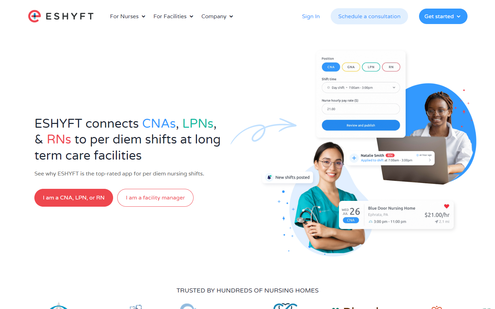
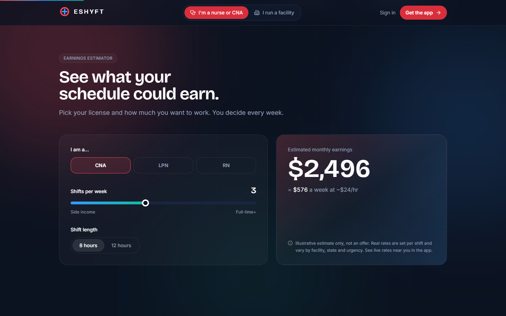
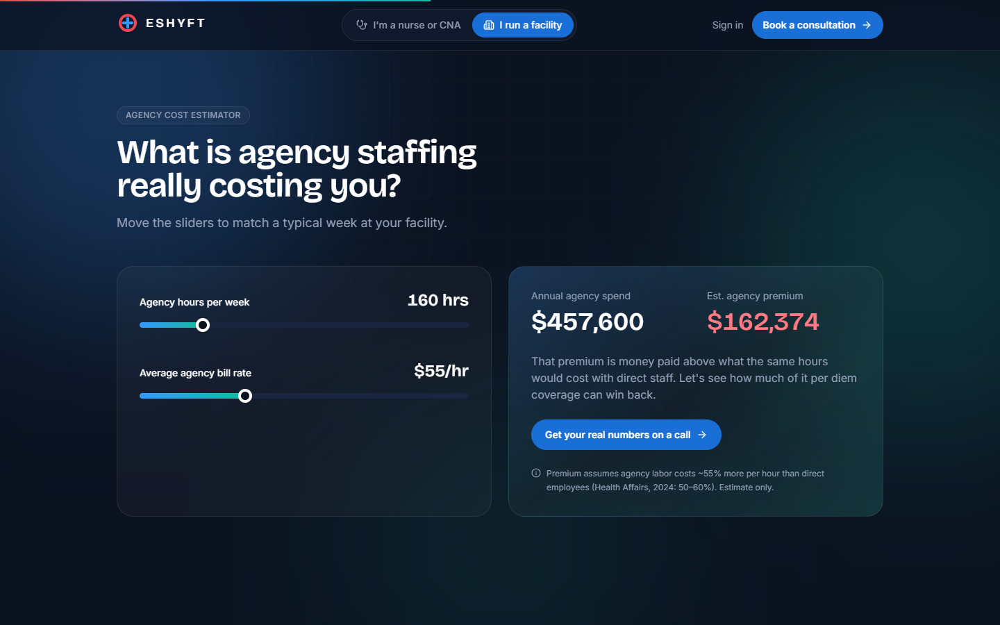
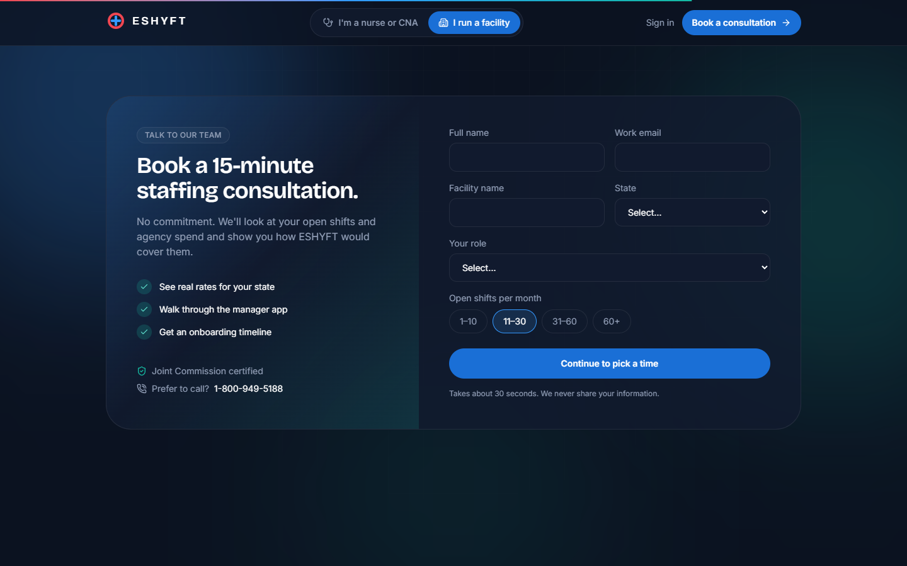
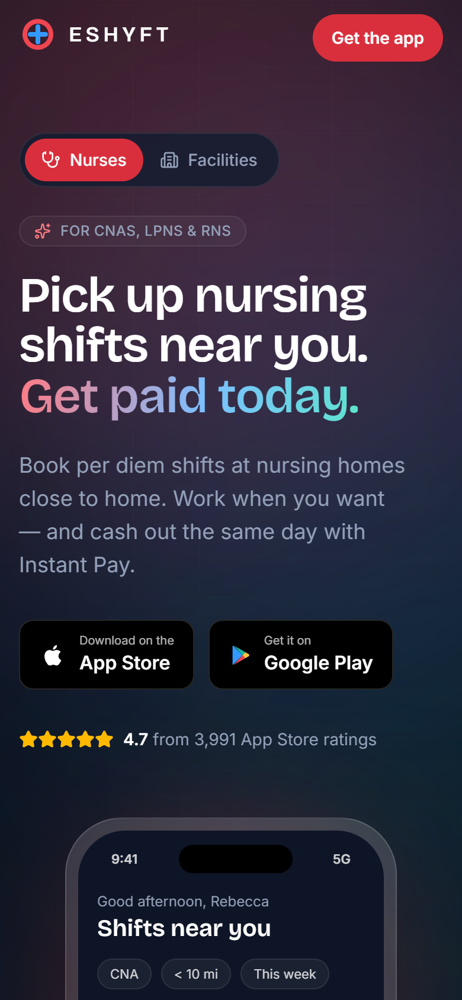
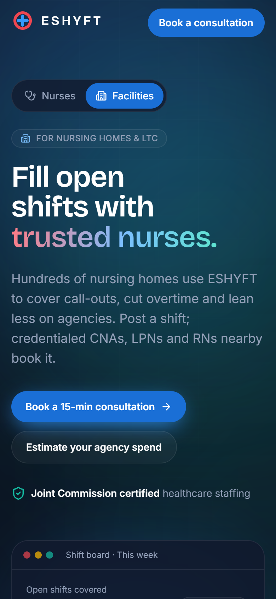

# Case study: redesigning ESHYFT's landing page for a two-sided marketplace

**Author:** Joseph Fan · **Date:** October 2026 · **Type:** Independent concept (not the official ESHYFT site)

---

## TL;DR

ESHYFT's homepage has to convert two very different visitors: **nurses**, who should download the app, and **facility managers**, who should book a sales consultation. The current page looks polished, but it serves both audiences at once. It has five competing header CTAs, makes proof claims it doesn't back up, gives facilities little persuasion, and scores **39/100** for mobile performance with a **27-second LCP** under Lighthouse's throttled mobile test.

I audited the page, researched what YC, Nielsen Norman Group and leading marketplaces recommend, and rebuilt it as an **audience-split, single-CTA, proof-first** experience with tasteful motion. The rebuild scores **93–100** on performance and **100** on accessibility, best practices and SEO, transfers **~250 KiB** (the live page transfers 5 MB), and instruments every step of both funnels so it can be A/B tested.

---

## Contents

1. [Context and goals](#1-context-and-goals)
2. [How I approached it](#2-how-i-approached-it)
3. [Audit of the current page](#3-audit-of-the-current-page)
4. [Research](#4-research)
5. [The improvements, one by one](#5-the-improvements-one-by-one)
6. [Choosing the stack](#6-choosing-the-stack)
7. [Performance & accessibility](#7-performance--accessibility)
8. [Measurement plan](#8-measurement-plan)
9. [Trade-offs and what I'd do next](#9-trade-offs-and-what-id-do-next)
10. [Fact sheet](#10-fact-sheet)
11. [Sources](#11-sources)

---

## 1. Context and goals

ESHYFT is a per diem staffing marketplace. **Supply** is CNAs, LPNs and RNs who pick up shifts. **Demand** is nursing homes and long-term care (LTC) facilities that post them. It operates in 30 states.

| Audience | Primary conversion | What they need to believe |
|---|---|---|
| **Nurses (supply)** | Download the nurse app | "I'll earn good money, on my schedule, near home, and get paid fast." |
| **Facilities (demand)** | Book a consultation with sales | "This will reliably fill my shifts with qualified people, cost less than agencies, and be low-risk to try." |

**Success metrics I designed for:**
- Nurse: store-badge click-through rate and QR/SMS link requests per visitor
- Facility: consult-form start rate, completion rate, and booked-meeting rate
- Guardrails: Core Web Vitals (LCP < 2.5 s, CLS < 0.1) and a WCAG AA accessibility score

---

## 2. How I approached it

```
Audit ──► Research ──► Principles ──► Design + build ──► Measure ──► (A/B test plan)
```

1. **Audit.** I walked the live page top to bottom, scraped its structure, ran Lighthouse, and pulled real App Store data for ESHYFT and 25+ competitors from the iTunes Search API.
2. **Research.** Y Combinator's website guidance, conversion research (NN/g, Unbounce, Google/Deloitte), marketplace growth writing (Lenny Rachitsky, Andrew Chen, NFX), and a teardown of how Airbnb, Uber, Lyft, DoorDash and six nurse-staffing competitors handle two audiences.
3. **Principles.** I distilled the research into rules I could check every design decision against (§5 intro).
4. **Design and build.** The site is a production-quality React build, not a mockup, so the performance and accessibility claims are measurable.
5. **Measure.** Lighthouse before and after. The analytics events are wired in so the next step, real A/B tests, is ready to run.

One rule throughout: **don't invent facts.** Every claim on the page is sourced from eshyft.com or a public API. Anything estimated (pay rates, savings) is labelled as illustrative on the page itself (§10).

---

## 3. Audit of the current page



To be fair to the current page: it has good bones. There's a two-button audience split in the hero, real app imagery, real nurse testimonials, a Joint Commission badge, and an Instant Pay feature. The problems are structural, not cosmetic.

| # | Finding | Evidence | Why it hurts conversion |
|---|---|---|---|
| A1 | **Too many competing CTAs** | The header alone has "Sign In", "Schedule a consultation", "Get started ▾", "Apply today" and "Schedule a call", with more in the hero and footer | Choice overload. "Get started" doesn't say for whom. The same action is called "consultation", "call" and "demo" |
| A2 | **One page serving two audiences** | Most of the page is nurse-focused (app, how it works, Instant Pay, testimonials). Facility persuasion is a logo strip plus links away | Facility managers, the higher-value conversion, get almost nothing to convince them on the homepage |
| A3 | **Unsupported proof** | "See why ESHYFT is the top-rated app…" with no rating shown. "Hundreds of nursing homes" is the only scale metric | NN/g: unsubstantiated claims reduce trust. The real rating (4.7★, 3,991 reviews) is strong but invisible |
| A4 | **Headline describes the company, not the benefit** | "ESHYFT connects CNAs, LPNs, & RNs to per diem shifts at long term care facilities" | Accurate, but a nurse wants to know what *they* get (money, flexibility, speed) |
| A5 | **No earnings information** | No pay ranges or estimator | Pay is the #1 reason nurses go per diem. Hiding it reads as "not open enough" (NN/g) |
| A6 | **Location list is a dead end** | 30 state links that all point to the same help article | It looks like content but answers nothing |
| A7 | **Hidden contact form** | The general "Contact us" form lives in a modal and isn't role-specific | Facility leads hit friction and generic routing |
| A8 | **No ROI argument on the homepage** | The ROI Calculator exists but is buried in the nav and footer | The strongest B2B argument, cost compared with agencies, is never made on the page |
| A9 | **Performance** | Lighthouse mobile: **Performance 39, LCP 27.1 s, TBT 690 ms, 5 MB, 172 requests** | Deloitte/Google found a 0.1 s mobile speed gain lifted lead-gen form progression by 21.6% |
| A10 | **Accessibility** | Lighthouse flags color contrast, heading order and unnamed links. Several images have filename alt text | Excludes users, and contrast failures also hurt readability outdoors on phones, where nurses browse |

---

## 4. Research

### 4.1 Y Combinator: clarity over cleverness

- **Explain it simply.** In YC's Design Review series, Aaron Epstein and Garry Tan test how fast a first-time visitor understands what the product does, and warn that clever copy backfires ([YC blog](https://www.ycombinator.com/blog/design-review-watch-aaron-and-garry)).
- **Show the product early** and lead with its most impressive capability ("feat of strength") (same source).
- **Michael Seibel's test:** write two sentences about what you do and ask someone to explain them back. "If they can't explain it, you are wrong, not them." ([Quartz](https://qz.com/africa/795674/how-to-get-into-y-combinator-ceo-michael-seibels-advice-to-nigerian-start-up-founders))
- **Marketplaces** face chicken-and-egg, supply/demand balance and trust problems. Solve the hard side first (YC office hours; see also §4.3).

**Applied:** headlines a nurse can repeat back ("Pick up nursing shifts near you. Get paid today."), the product shown animated in the hero, and the strongest proof placed next to the CTA.

### 4.2 Conversion research

- **Attention is front-loaded.** About 57% of viewing time is above the fold and about 74% is in the first two screens ([NN/g, Scrolling and Attention](https://www.nngroup.com/articles/scrolling-and-attention/)). Proof has to be in the first two screenfuls, which is why I added a proof bar directly under the hero.
- **F-pattern scanning.** Front-load headings with the words that carry information ([NN/g](https://www.nngroup.com/articles/f-shaped-pattern-reading-web-content/)).
- **Trust** comes from design quality, upfront disclosure (prices, contact), comprehensive content, and connection to the rest of the web. **Third-party proof beats self-reported testimonials** ([NN/g, Trustworthy Design](https://www.nngroup.com/articles/trustworthy-design/)). That led to App Store ratings over "top-rated", and a visible phone number.
- **Reading level.** Unbounce's benchmark found pages written at a 5th–7th grade level convert at an 11.1% median, against 5.3% for college-level copy (reported via [MarketingProfs](https://marketingprofs.com/charts/2024/52374/landing-page-conversion-benchmarks)).
- **Speed.** "Milliseconds Make Millions" (Deloitte/Google, 37 brands): a 0.1 s mobile speed improvement was associated with **+21.6% progression to form submission on lead-gen sites** ([web.dev](https://web.dev/case-studies/milliseconds-make-millions)). This is correlational, but directionally strong.

### 4.3 Marketplace playbooks

- **"Supply is king."** Lenny Rachitsky (ex-Airbnb): state the supply value proposition "boldly and directly". Put supply call-outs everywhere, "more aggressive than you're comfortable with". **Earnings estimates were "an order of magnitude more effective than any other value prop"** for Airbnb hosts, and growth dipped when they were hidden ([28 ways to grow supply](https://andrewchen.com/grow-marketplace-supply/)).
- **Win the hard side first.** In *The Cold Start Problem*, Andrew Chen calls the supply side the "hard side": harder to acquire and retain, and it creates disproportionate value ([andrewchen.com](https://andrewchen.com/solve-a-hard-problem-cold-start-problem/)). This is why **nurses are the default view**.
- **NFX's chicken-or-egg tactics** include getting the hardest side first and giving each side standalone value ([NFX](https://www.nfx.com/post/19-marketplace-tactics-for-overcoming-the-chicken-or-egg-problem)).

### 4.4 Competitive teardown

**How two-sided marketplaces split their audiences:**

| Company | Pattern | Supply-side hook |
|---|---|---|
| Airbnb | Separate "Airbnb your home" page | **Earnings estimator in the hero** |
| Uber | Demand-first homepage; separate Drive page | "Drive when you want, make what you need"; Instant Pay |
| Lyft | Separate driver page | **Phone-number capture in the hero**; named driver testimonials |
| DoorDash | Separate Dasher subdomain | Phone capture; pay explained; instant cash-out |
| Clipboard | Dual CTAs side by side | **Quantified fill rate** ("95% of shifts get staffed when posted a day in advance"); facility-role testimonials |
| Nursa | Nav tabs: Clinicians / Facilities | **Shows average pay by role and city** |
| CareRev | Dual headline, dual CTAs | Savings stats for hospitals |
| ShiftMed | Facility-first | **Savings calculator** for facilities |

Sources: each site, fetched 2026-10-16. Upwork, Fiverr, Thumbtack and Instacart blocked automated fetching, so I left them out rather than describe them from memory.

**Patterns I adopted:**
1. Each audience gets its own focused experience with its own CTA.
2. The supply side leads with money and flexibility, plus fast pay.
3. The supply side captures intent in the hero (a phone number or app download).
4. The demand side leads with outcomes (coverage) and cost, then de-risks the call.

**App Store ratings, collected from the iTunes Search API on 2026-10-16:**

| App | Rating | # ratings |
|---|---|---|
| CareRev | 4.80 | 1,675 |
| Nursa | 4.75 | 7,749 |
| **ESHYFT – Per Diem Nursing** | **4.72** | **3,991** |
| ShiftKey | 4.69 | 27,535 |
| Clipboard – Workers | 4.63 | 22,913 |
| IntelyCare | 4.19 | 1,199 |
| ShiftMed | 3.12 | 1,025 |

ESHYFT's rating is **among the best in the category**, and **none of these competitors show their rating on their homepage**. This is cheap, verifiable differentiation, so it goes right under the hero CTA.

### 4.5 What each side actually cares about

- **Facilities.** Agency staff cost nursing homes **50–60% more per hour** than direct employees. The share of homes using agency staff rose from 23% (2018) to nearly half (2022), and heavier agency use correlated with lower CMS star ratings (Health Affairs 2024, via [Skilled Nursing News](https://skillednursingnews.com/2024/02/states-where-nursing-homes-used-the-most-agency-nursing-staff-in-2022/)). Facilities also care about fill rate and speed, credentialing and compliance (Joint Commission certification), and continuity of care.
- **Nurses.** Pay rate is the main reason to go per diem, flexibility now rivals pay as a satisfaction driver, and fast or instant pay appears in every competitor's supply pitch.

---

## 5. The improvements, one by one

**Principles I checked every decision against:**
1. **One audience, one goal, one CTA per view.**
2. **Benefit first, in plain words** (~6th-grade reading level).
3. **Show, don't tell.** Put the product in the hero.
4. **Prove it with third-party, specific numbers.** Never invent them.
5. **Answer the objection before it's raised.**
6. **Fast and accessible are features,** not polish.

Each improvement below is written as problem → evidence → solution → how I'd measure it.

### 5.1 Split the page by audience
- **Problem:** A1, A2. Both audiences share one scroll and one header full of CTAs.
- **Evidence:** Airbnb, Uber, Lyft and DoorDash all give supply its own page. NN/g's attention data says you get about two screens to make your case.
- **Solution:** An **audience toggle** ("I'm a nurse or CNA" / "I run a facility") in the nav, and in the hero on mobile. It swaps the entire page with a blur-crossfade. The choice lives in the URL hash (`#nurses` / `#facilities`), so:
  - paid ads, emails and sales reps can **deep-link** to the right side
  - the back button works
  - the facility page is **code-split** and loads only when someone asks for it
- **Default = nurses,** the hard side (Chen). A cross-sell card at the bottom of each view offers the other side, so a facility manager is never stuck.
- **Measure:** `audience_selected` events (with source: toggle, cross-sell, footer), and bounce rate split by first view.

### 5.2 One contextual CTA
- **Problem:** A1. There are five header CTAs with three names for the same action.
- **Solution:** The nav has exactly one primary button. It reads **"Get the app"** for nurses and **"Book a consultation"** for facilities. "Sign in" becomes a quiet text link. On mobile, a **sticky thumb-zone CTA** appears after the hero scrolls away and goes straight to the right store for iOS or Android.
- **Measure:** `cta_clicked` by location (nav, hero, sticky, footer CTA).

### 5.3 Benefit-first headlines
- **Problem:** A4.
- **Before:** "ESHYFT connects CNAs, LPNs, & RNs to per diem shifts at long term care facilities."
- **After (nurse):** "Pick up nursing shifts near you. **Get paid today.**"
- **After (facility):** "Fill open shifts with **trusted nurses.**"
- **Why:** Each passes Seibel's explain-it-back test, leads with the outcome, and is written at about a 6th-grade level (Unbounce). The supporting line carries the specifics: per diem, nursing homes, Instant Pay.

### 5.4 Replace "top-rated" with the actual rating
- **Problem:** A3.
- **Solution:** Show **★ 4.7 from 3,991 App Store ratings** right under the download CTA, and again in the proof bar and the testimonials section. The facility page shows the manager app's 4.7★.
- **Why:** It's verifiable third-party proof (NN/g), it's competitively strong (§4.4), and no competitor does it.

### 5.5 Nurse earnings estimator
- **Problem:** A5.
- **Evidence:** Airbnb's earnings estimator finding (Rachitsky). Nursa is the only nurse competitor that shows pay, and it uses static tables.
- **Solution:** An interactive estimator: pick a license (CNA/LPN/RN), shifts per week (1–6) and shift length (8/12 h). It shows monthly and weekly estimates that spring smoothly between values.
- **Honesty:** The rates are **illustrative** (CNA $24, LPN $38, RN $48/h, in line with public ranges Nursa shows), and this is disclosed in the UI. In production I'd feed it live median posted rates by role and state.
- **Measure:** `calculator_used`, and download rate for users who touched the estimator compared with users who didn't.

### 5.6 Desktop-to-mobile bridge
- **Problem:** The conversion happens on a phone, but some visitors arrive on desktop.
- **Solution:**
  - **Mobile:** native store badges.
  - **Desktop (≥1024 px):** a **QR code** plus a **"Text me the link"** phone field. This is the Lyft/DoorDash pattern of capturing intent in the hero.
- **Production note:** The QR and SMS would use a smart link (Branch/AppsFlyer) carrying UTM attribution.

### 5.7 Show the product, animated
- **Evidence:** "Show the product early" (YC).
- **Nurse hero:** A coded phone mockup loops the core job: shifts near you → tap **Book shift** → **Booked** → an *Instant Pay sent* notification.
- **Facility hero:** A shift board where open shifts flip to **Filled**, showing the matched nurse and their rating, while a coverage bar climbs to 4/4. It shows the outcome facilities buy.
- **Why code, not screenshots:** It's crisp at any pixel density, adds almost no bytes, works in dark mode, and the copy is easy to change.

### 5.8 State checker instead of a dead-end list
- **Problem:** A6.
- **Solution:** "Is ESHYFT in your state?" A search box gives an instant yes or no ("Not yet — download to get notified"), and the matching tile on a 30-state grid lights up.
- **Measure:** `state_checked` (with a found flag). A miss also signals expansion demand.

### 5.9 Instant Pay gets its own moment
- **Evidence:** Fast pay is in every supply-side competitor's pitch (Uber, Lyft, DoorDash, ShiftKey, ShiftMed).
- **Solution:** A three-step timeline (clock out → tap "Cash out" → money on its way) that animates in, plus the fact that it's powered by Stripe.

### 5.10 Testimonials made credible
- **Solution:** Real quotes from eshyft.com, each tagged with **license and state** so readers find someone like them, shown in a CSS marquee that pauses on hover. The verified rating sits right above them.
- **Next step:** Add photos and tenure ("8 months on ESHYFT"), as Lyft does.

### 5.11 Facility page: pain → fix
- **Problem:** A2. Facilities had no persuasion on the homepage.
- **Solution:** Four cards name the pain in the buyer's own words, then resolve it: the 5 a.m. call-out, overtime and agency bills, compliance risk, and "another system to learn". An animated strike-through crosses out each pain.

### 5.12 Agency-cost estimator
- **Problem:** A8.
- **Evidence:** Health Affairs: agency staff cost 50–60% more per hour.
- **Solution:** Two sliders, agency hours per week and agency bill rate. The output is **annual agency spend** and the **estimated premium** over direct-staff cost (55% midpoint, so the premium is spend × 0.55 / 1.55).
- **What it deliberately doesn't do:** claim "ESHYFT saves you X%". I don't have that data, and B2B buyers spot made-up numbers. The calculator **quantifies the pain**, and the CTA ("Get your real numbers on a call") hands off to sales.
- **Measure:** `calculator_used`, and consult rate after using the calculator.

### 5.13 Consult form → instant scheduling
- **Problem:** A7. The contact form is hidden in a modal and isn't role-specific.
- **Solution:**
  - A **visible**, two-column section with what you get from the call, a trust badge, and a phone fallback.
  - **Six fields**, with one-tap chips for "open shifts per month".
  - On submit, the user **picks a time slot immediately** instead of "someone will reach out". This is the Chili Piper/Calendly pattern that shortens time-to-meeting.
  - Fields use proper `autocomplete` and labels.
- **Production note:** POST to the CRM with UTM and calculator context, and route by state or size to the right account executive's calendar.
- **Measure:** `consult_form_started`, `consult_form_submitted`, and booked-meeting rate.

### 5.14 Objection handling
- A short **process** section ("15-minute consultation → onboarding and integrations → post shifts, see them fill"). Telling buyers what happens next lowers the perceived cost of the form.
- **FAQs** for each audience, written only from facts on eshyft.com.

---

## 6. Choosing the stack

I compared the current options in October 2026 (versions from npm, 2026-10-16):

| Option | Verdict |
|---|---|
| **Vite 8 + React 19** | ✅ Simplest static build, fast iteration, deploys anywhere |
| Astro 7 | Best zero-JS ceiling. A strong alternative, but cross-island state (the audience toggle) adds wiring |
| Next.js 16 | Overkill for one static page |
| **Tailwind CSS v4** | ✅ CSS-first `@theme` tokens, no config file |
| shadcn/ui, Magic UI, Aceternity | Good copy-paste sources. I hand-built the handful of components I needed to keep full control of motion and accessibility |
| **Motion 14** (`motion/react`) | ✅ Layout and presence animations, springs, scroll hooks. Loaded via `LazyMotion` with **async features** (~19 KB gzip off the critical path) |
| GSAP 3.15 (now free) | Most powerful for pinned or scrubbed timelines, but adding a second engine isn't worth it here |
| **Lenis** | ✅ ~4 KB smooth scroll. **Disabled under reduced motion** (Lenis doesn't do this itself) |
| Lottie, Rive, Three.js | Each 100–250 KB+. Rejected: no animation here needs them |

**Implementation choices worth calling out:**
- **Design tokens** come from ESHYFT's real brand palette (coral `#EF4651`, sky `#3399FF`, teal `#15BAA2`), placed on a dark "night shift" canvas so the colors read as light sources. The ambient background shifts from coral to blue when you switch audience.
- **All copy lives in `src/data/content.ts`,** typed, with sourced facts separated from illustrative values.
- **The CSS marquee duplicates its content** and translates by -50%, so it costs no JavaScript per frame and pauses on hover.

---

## 7. Performance & accessibility

**Lighthouse 12, run on 2026-10-16:**

| Metric | Live eshyft.com (mobile) | Redesign: nurse (mobile) | Redesign: facility (mobile) | Redesign (desktop) |
|---|---|---|---|---|
| Performance | 39 | 95 | 93 | 100 |
| Accessibility | 91 | 100 | 100 | 100 |
| Best practices | 75 | 100 | 100 | 100 |
| SEO | 92 | 100 | 100 | 100 |
| LCP | 27.1 s | 2.4 s | 2.9 s | 0.5 s |
| TBT | 690 ms | 30 ms | 10 ms | 0 ms |
| CLS | 0 | 0 | 0 | ≤ 0.004 |
| Transfer size | 5,042 KiB | 247 KiB | 254 KiB | — |
| Requests | 172 | 7 | 8 | — |

**Caveats (read these):**
- The redesign was served from a local preview server, and the live site from production. Lighthouse's simulated throttling narrows that gap but doesn't remove it.
- The live page includes real-world weight a concept doesn't: tag managers, chat widgets, Gravity Forms, a WordPress/Elementor runtime.
- The fair conclusion: **the architecture and asset choices behind the live page cost a lot**, and a focused rebuild can be an order of magnitude lighter.

**How the redesign got there:**
- **The LCP element (the H1) is never hidden.** It renders immediately, and only the elements around it animate in. Hiding hero text behind `opacity: 0` is the most common way animated sites ruin their LCP.
- **The UI is built in code instead of images.** The page has no raster images at all.
- **Code-splitting:** the facility page and Motion's animation features are lazy chunks.
- **Self-hosted variable fonts,** loaded only for the scripts the page uses (unicode-range subsets).
- **Only `transform` and `opacity` are animated,** and continuous loops are pure CSS.

**Accessibility:**
- **Brand colors fail WCAG AA with white text.** White on coral `#EF4651` is **3.71:1** and white on sky `#3399FF` is **2.94:1**; AA needs 4.5:1. Lighthouse flags exactly these pairs on the live site, including the hero's colored "CNAs / LPNs / RNs" words (teal on white is 2.44:1) and the "I am a CNA, LPN, or RN" button. I added `-strong` shades for filled buttons: coral `#D92F3C` (4.75:1) and sky `#1A6FD6` (4.90:1). The bright brand hues stay for glows and accents.
- **Reduced motion:** the audience toggle is a proper `radiogroup`. `MotionConfig reducedMotion="user"` covers the animations, a global CSS rule stops the marquees and float loops, and Lenis is turned off.
- **Screen readers:** animated counters and calculator values expose the **final value** to screen readers via `sr-only` text and a single `aria-live` region, instead of announcing every animation frame. The FAQ uses `aria-expanded`/`aria-controls`.
- **Keyboard:** there's a skip link, visible `:focus-visible` rings, and labelled form fields with `autocomplete`.

---

## 8. Measurement plan

**Events** (in `src/lib/analytics.ts`; GTM-compatible `dataLayer`):

| Event | Funnel step |
|---|---|
| `audience_selected` {audience, source} | Segmentation |
| `cta_clicked` {cta, location, audience} | Intent |
| `store_badge_clicked` {store, location} | **Nurse conversion (proxy)** |
| `calculator_used` {calculator} | Engagement |
| `state_checked` {query, found} | Engagement / expansion signal |
| `consult_form_started` → `consult_form_submitted` | **Facility conversion** |

**A/B tests I'd run first, in priority order:**
1. **Audience default.** Nurse-first against a neutral "choose your side" hero. Primary metric: combined conversions per visitor.
2. **Estimator placement.** Estimator in the hero against below the fold. Metric: store clicks.
3. **Facility hero proof.** A fill-rate stat (if ESHYFT can publish one, the way Clipboard does) against the Joint Commission badge alone. Metric: consult starts.
4. **Instant scheduling against "we'll be in touch."** Metric: booked-meeting rate and show rate.

---

## 9. Trade-offs and what I'd do next

- **Single page with a toggle, or separate URLs?** I chose a hash-routed toggle for the portfolio's interactivity and instant switching. In production I'd give each side its own **pre-rendered URL** (`/nurses`, `/facilities`) for SEO and ad Quality Score, and keep the toggle as navigation between them.
- **Data I'd want before shipping:** a real fill-rate or time-to-fill stat, median pay by role and state for the estimator, facility testimonials from administrators and DONs, and logo usage permission.
- **Client-side rendering:** fine for this page's Lighthouse scores, but I'd pre-render the HTML (Vite SSG or Astro) to make the first paint independent of JavaScript.
- **Internationalization:** many CNAs are bilingual, so I'd test a Spanish variant of the nurse page.
- **Referral loop:** Airbnb's most efficient supply lever was referrals (Rachitsky). I'd add a "refer a nurse friend" module once the core funnel is validated.

---

## 10. Fact sheet

Every factual claim on the page and where it came from:

| Claim | Source |
|---|---|
| Live in 30 states (list of states) | eshyft.com "Our Locations" |
| "Hundreds of nursing homes" | eshyft.com |
| Joint Commission certified | eshyft.com footer (Gold Seal) |
| Instant Pay, powered by Stripe; weekly pay | eshyft.com Instant Pay section |
| Browse by rate/date/distance; book and accept invites; clock in/out in app | eshyft.com "How ESHYFT works" |
| Nurse app 4.7★ / 3,991 ratings; manager app 4.7★ / 59 ratings | iTunes Search API, 2026-10-16 |
| Testimonial quotes | eshyft.com "Nurses ❤️ ESHYFT" (verbatim) |
| Customer names in the logo marquee | eshyft.com logo strip (shown as text wordmarks) |
| Technology integrations, ROI calculator, facility manager app | eshyft.com nav and footer |
| Agency staff cost 50–60% more per hour | Health Affairs 2024, via Skilled Nursing News |

**Labelled as illustrative on the page:**
- Nurse hourly rates in the estimator
- The 55% premium midpoint
- The $216 Instant Pay example
- Facility names and shift times in the mockups

---

## 11. Sources

- YC — [Design Review with Aaron Epstein & Garry Tan](https://www.ycombinator.com/blog/design-review-watch-aaron-and-garry)
- Michael Seibel — two-sentence test ([Quartz](https://qz.com/africa/795674/how-to-get-into-y-combinator-ceo-michael-seibels-advice-to-nigerian-start-up-founders))
- NN/g — [Scrolling and Attention](https://www.nngroup.com/articles/scrolling-and-attention/) · [F-Shaped Pattern](https://www.nngroup.com/articles/f-shaped-pattern-reading-web-content/) · [Trustworthy Design](https://www.nngroup.com/articles/trustworthy-design/)
- Unbounce Conversion Benchmark (via [MarketingProfs](https://marketingprofs.com/charts/2024/52374/landing-page-conversion-benchmarks))
- Deloitte & Google — [Milliseconds Make Millions](https://web.dev/case-studies/milliseconds-make-millions) · [Vodafone LCP case study](https://web.dev/case-studies/vodafone)
- Lenny Rachitsky — [28 ways to grow supply in a marketplace](https://andrewchen.com/grow-marketplace-supply/) · [How to kickstart and scale a marketplace](https://www.lennysnewsletter.com/p/how-to-kickstart-and-scale-a-marketplace)
- Andrew Chen — [Solve a hard problem (The Cold Start Problem)](https://andrewchen.com/solve-a-hard-problem-cold-start-problem/)
- NFX — [19 Tactics to Solve the Chicken-or-Egg Problem](https://www.nfx.com/post/19-marketplace-tactics-for-overcoming-the-chicken-or-egg-problem)
- Skilled Nursing News — [Agency staffing in nursing homes, 2022](https://skillednursingnews.com/2024/02/states-where-nursing-homes-used-the-most-agency-nursing-staff-in-2022/)
- The Joint Commission — [Health Care Staffing Services Certification](https://jointcommission.org/resources/news-and-multimedia/fact-sheets/facts-about-health-care-staffing-services-certification)
- Marketplace pages: [Airbnb Host](https://www.airbnb.com/host/homes) · [Uber Drive](https://www.uber.com/us/en/drive/) · [Lyft Driver](https://www.lyft.com/driver) · [DoorDash Dasher](https://dasher.doordash.com/en-us) · [Clipboard](https://www.clipboard.com/) · [Nursa](https://nursa.com/) · [CareRev](https://www.carerev.com/) · [ShiftKey](https://www.shiftkey.com/) · [IntelyCare](https://www.intelycare.com/) · [ShiftMed](https://www.shiftmed.com/)
- Libraries — [Motion: reduce bundle size](https://motion.dev/docs/react-reduce-bundle-size) · [Tailwind v4 upgrade guide](https://tailwindcss.com/docs/upgrade-guide) · [GSAP is now free](https://webflow.com/blog/gsap-becomes-free) · [Lenis](https://github.com/darkroomengineering/lenis)

---

### More screenshots

| Earnings estimator | Agency-cost estimator |
|---|---|
|  |  |

| Consultation form | Mobile (nurse) | Mobile (facility) |
|---|---|---|
|  |  |  |
